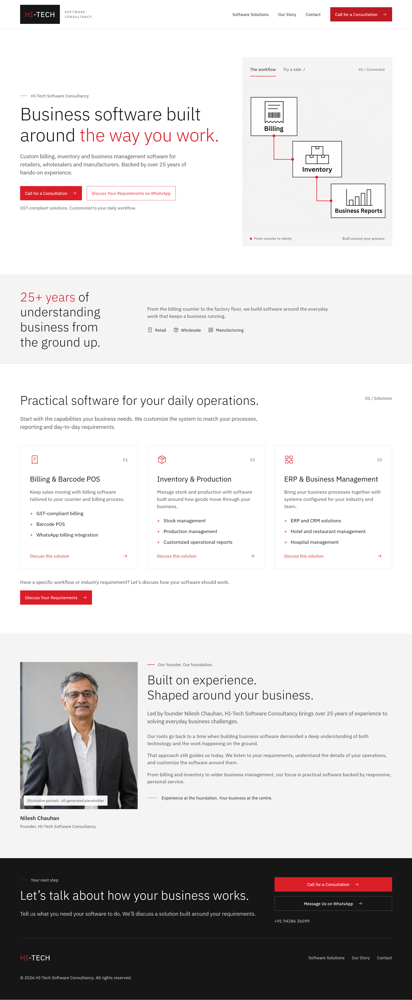
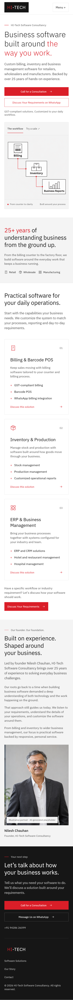

# HI-Tech Website Case Study

**A documented design and development process for a custom business-software consultancy website.**

This project follows a structured path from a business brief and wireframe to user-selected component research, implementation, and validation. It is currently in **Phase 2: Component Research & Refinement**. The archived baseline already contains animations and an interactive illustration; the final website has not been implemented or deployed.

## The brief

HI-Tech Software Consultancy builds software for retail, wholesale, and manufacturing businesses. The landing page should communicate its 25+ years of experience, explain its billing/POS, inventory/production, and ERP capabilities, and encourage a phone call or WhatsApp consultation.

The design direction combines IBM Plex Sans, a 12-column grid, generous whitespace, and the business's red accent. Gestalt principles guide grouping and hierarchy. Motion should explain or reinforce interactions without overwhelming the content.

## Project status

| Stage | Status | Evidence |
| --- | --- | --- |
| Phase 1: baseline and design foundations | Archived; final visual approval remains incomplete | [Phase notes](docs/phases/01-baseline.md) |
| Phase 2: component research and refinement | In progress; user preparing Canva annotations and assets | [Research notes](docs/phases/02-component-research.md) |
| React implementation and selected interactions | Planned; no migration yet | [Design contract](DESIGN.md) |
| Final validation and launch | Planned | Results will be recorded when performed |
| Final project showcase | Working outline | [Case study](CASE-STUDY.md) |

## Explore the work

- [Design contract](DESIGN.md): typography, grid, palette, Gestalt applications, motion, and sourcing rules.
- [Agent instructions](AGENTS.md): project workflow and quality requirements.
- [Project Gestalt skill](.agents/skills/hi-tech-gestalt/SKILL.md): concrete component-level design rules.
- [Asset provenance and credits](docs/ASSETS-AND-CREDITS.md): supplied assets, generated imagery, and third-party attribution.
- [Original build notes](phase-1-wireframe/BUILD-NOTES.md): baseline implementation details and prior verification.

<details>
<summary>View the archived desktop baseline</summary>



</details>

<details>
<summary>View the archived mobile baseline</summary>



</details>

## Run the baseline

Open `phase-1-wireframe/index.html` in a browser. The generated images and Anatomy SVG are embedded. An internet connection is needed for the requested Tailwind, GSAP, ScrollTrigger, and Google Fonts CDNs.

Alternatively, from the repository root:

```sh
python -m http.server 4173 --bind 127.0.0.1
```

Then visit **http://127.0.0.1:4173/phase-1-wireframe/**. Stop the server with Ctrl+C.

There is no React application or npm development command yet. The proposed next-phase stack is React, TypeScript, Vite, compiled Tailwind, and GSAP. Three.js/React Three Fiber will be considered only for a selected 3D feature.

## How the process is documented

The project owner supplies assets and annotated desktop/mobile layouts through Canva, using matching section IDs and explicit component links. Decisions record what was selected, why it fits the brief, how it changes the baseline, and what was tested. Later phases will add their own evidence when work takes place.

AI tools assist with research, design interpretation, image generation, implementation, and verification. The project owner supplies the business direction, chooses references, and reviews the result. Generated imagery is identified; proposals are distinguished from completed work.

The initial Git commit captures the existing workspace retrospectively. It does not claim that earlier design steps occurred as separate commits. Later commits will document actual changes; completed milestones can receive descriptive tags.

## Validation and limitations

The baseline build notes record earlier Playwright checks across five viewport widths, interactions, reduced motion, and CDN failure behavior. Its archived scripts contain machine-specific Chromium paths and require Playwright; they are reference evidence, not a portable automated test suite. This repository setup validates documentation links, tracked-file selection, and baseline integrity; it does not establish final accessibility or performance scores.

The founder portrait is a fictional AI-generated placeholder. The baseline uses a provisional text logo and Tailwind's browser CDN. Replacement brand assets, compiled production CSS, final testing, and deployment remain future work.

## Rights and attribution

This repository is publicly viewable for process documentation. Public visibility is not a blanket license to reuse business branding, images, or all code. No project-wide open-source license has been selected. Preserve the applicable third-party notices, including the [Anatomy MIT license](phase-1-wireframe/assets/anatomy-LICENSE.txt). See [credits](docs/ASSETS-AND-CREDITS.md) for current provenance and limitations.
